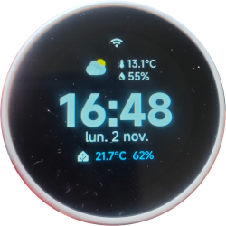
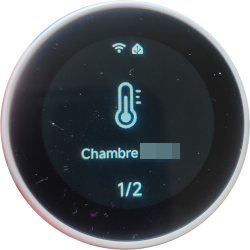
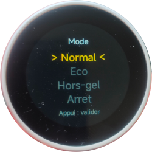
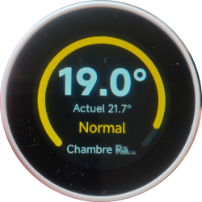
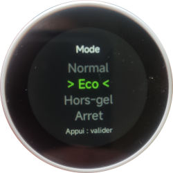
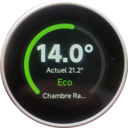
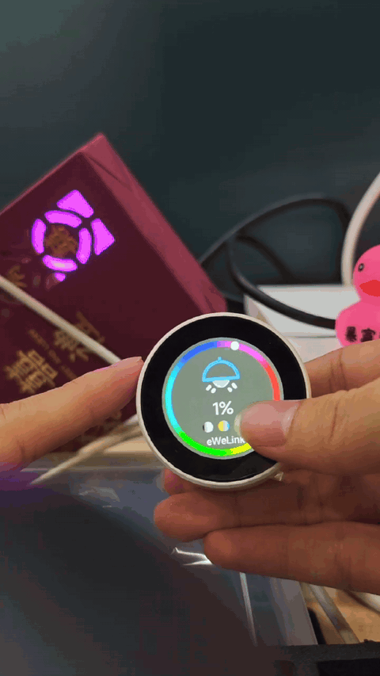

[README EN](README.en_EN.md)

Projet de firmware ESPHome pour l'afficheur rotatif **ONX2424G013**. Il utilise un **ESP32-S3**, **ESP-IDF**, **LVGL** ainsi que des composants personnalisés intégrés afin de fournir un panneau de contrôle local pour **Home Assistant**.

## A propos de ce Fork

Ce fork apporte de nouvelles fonctionnalités notamment pour piloter des chauffages. 
Le developpement des nouvelles fonctionalités est assisté par Claude (free/sonnet 5.5)

## Fonctionnalités d'origine

- Contrôle des interrupteurs, lumières, prises connectées, volets et automatisations Home Assistant depuis l'écran.
- Prise en charge du bouton rotatif avec fonction poussoir.
- Réglage de la luminosité de l'écran et des modes veille.
- Affichage de la météo en mode veille.
- Configuration Wi-Fi par portail captif lorsqu'aucun réseau n'est configuré.
- Prise en charge des mises à jour OTA via manifeste HTTPS. L'image OTA actuelle est disponible dans le dossier `firmware/`.

La configuration principale se trouve dans **ONX2424G013.yaml**.

Le matériel cible utilise un **ESP32-S3** avec :

- 16 Mo de mémoire Flash
- PSRAM Octal
- Écran rond GC9A01A

Ce firmware doit uniquement être utilisé avec un matériel compatible **ONX2424G013**.

## Nouvelles fonctionnalités

- Ajout du capteur de température et d'humidité [SHT31-D](docs/Sonde.jpg) avec affichage des données sur l'écran d'accueil et remontée vers Home Assistant.
  Le capteur est branché en I2C SDA sur pin 10 et SCL sur pin 11. pour fonctionner il nécessite 3.3V j'ai mis un [regulateur](docs/Regulateur.jpg) sur la sortie 5V 
- Ajout de la sélection d'une entité "climate" (Thermostat) dans Home Assistant.
- Ajout du changement de température et du mode de fonctionnement directement depuis l'écran.
- Changement du comportement au réveil, lorsque l'on tourne la molette on est sur l'écran d'accueil (auparavant sur les entités)
- Heure en mode France (jour, mois, année); Icone Home Assistant placée devant les valeurs du capteur.

## Images

<p align="center">
  
  
  
  
  
  
  
</p>

## A faire

- Ajout de la possibilité de choisir la météo comme entité, et de faire remonter sur l'écran la météo heure par heure, ou s'il va pleuvoir dans l'heure
- Pouvoir changer de langue dans settings

## DEMO (du dépot d'origine)

<p align="center">
  
</p>


## Prérequis

Compilez ce projet avec **ESPHome 2026.6.3**.

L'utilisation de Docker est recommandée afin de garantir des versions cohérentes d'ESPHome, PlatformIO et ESP-IDF.

### Logiciels requis

- Docker, ou un environnement Python local avec `esphome==2026.6.3`
- Un accès Internet lors de la première compilation pour télécharger les dépendances
- Un câble USB compatible données pour le flashage série

## Clonage et compilation

Clonez d'abord le dépôt complet. La configuration dépend des dossiers suivants :

- `packages`
- `my_components`
- `assets`
- `fonts`

```bash
git clone https://github.com/OpenNextion/OpenNextion-Example-ESPHome_KNOB_Control.git
cd OpenNextion-Example-ESPHome_KNOB_Control
```

### Docker (recommandé)

#### Linux/macOS

```bash
docker run --rm \
  -v "$PWD":/config \
  -w /config \
  ghcr.io/esphome/esphome:2026.6.3 \
  compile ONX2424G013.yaml
```

#### Windows PowerShell

```powershell
docker run --rm -v "${PWD}:/config" -w /config ghcr.io/esphome/esphome:2026.6.3 compile ONX2424G013.yaml
```

### ESPHome local

```bash
python -m pip install "esphome==2026.6.3"
esphome version
esphome compile ONX2424G013.yaml
```

Après une compilation réussie, le firmware destiné à une première installation via navigateur se trouve dans :

```text
.esphome/build/onx2424g013/.pioenvs/onx2424g013/firmware.factory.bin
```

Pour les téléversements série ultérieurs, utilisez le fichier firmware indiqué dans la sortie de compilation ESPHome.

## Flashage via USB

Docker est la méthode recommandée pour compiler et flasher ce projet.

### Docker (Linux)

```bash
docker run --rm \
  --device=/dev/ttyACM0 \
  -v "$PWD":/config \
  -w /config \
  ghcr.io/esphome/esphome:2026.6.3 \
  run --device /dev/ttyACM0 ONX2424G013.yaml
```

Remplacez `/dev/ttyACM0` par le port série correspondant à votre appareil.

Si l'appareil ne passe pas automatiquement en mode téléchargement :

1. Maintenez le bouton **BOOT** (GPIO0).
2. Appuyez brièvement sur **RESET** (si disponible).
3. Relâchez **BOOT** lorsque le téléversement démarre.

Redémarrez l'appareil une fois le transfert terminé.

### ESPHome CLI locale

Si ESPHome est installé localement :

```bash
esphome run ONX2424G013.yaml
```

Ou en précisant le port série :

```bash
esphome run --device /dev/ttyACM0 ONX2424G013.yaml
```

Sous Linux :

```text
/dev/ttyACM0
/dev/ttyUSB0
```

Sous Windows :

```text
COM3
```

## Installation via navigateur (premier flash)

Pour une installation depuis un navigateur :

1. Ouvrez ESPHome Web dans Chrome ou Edge.
2. Connectez l'appareil.
3. Sélectionnez un firmware de type Factory.

Cette méthode nécessite un navigateur basé sur Chromium prenant en charge Web Serial, mais ne requiert pas l'installation locale d'ESPHome.

### Compilation locale

Sélectionnez :

```text
.esphome/build/onx2424g013/.pioenvs/onx2424g013/firmware.factory.bin
```

après compilation.

### Sans compilation locale

Téléchargez :

```text
onx2424g013.factory_v1.0.1.bin
```

depuis la publication **v1.0.1**, puis sélectionnez ce fichier dans ESPHome Web.

## Manuel utilisateur

Pour la configuration de l'appareil, le provisionnement Wi-Fi, l'intégration Home Assistant, l'utilisation de l'écran et les mises à jour OTA, consultez le manuel utilisateur en ligne :

https://opennextion.github.io/OpenNextion-Example-ESPHome_KNOB_Control/

## Structure du projet

- `ONX2424G013.yaml` : configuration principale ESPHome.
- `packages/` : configuration modulaire du matériel, du réseau, de l'affichage, des entrées et des fonctionnalités.
- `my_components/` : composants ESPHome personnalisés.
- `assets/` et `fonts/` : ressources graphiques et polices.
- `docs/` : images et supports de démonstration du README.
- `firmware/` : image OTA et manifeste de mise à jour.
- `User Manual/` : manuel utilisateur web intégré.

## Dépannage

1. **Le port série n'est pas détecté :**
   Utilisez un câble USB compatible transfert de données, vérifiez que le système d'exploitation détecte correctement le périphérique série et assurez-vous qu'aucune autre application n'utilise ce port.

2. **Les ressources ou composants sont introuvables lors de la compilation :**
   Exécutez les commandes depuis la racine du dépôt cloné et conservez l'ensemble des répertoires du projet.

  
